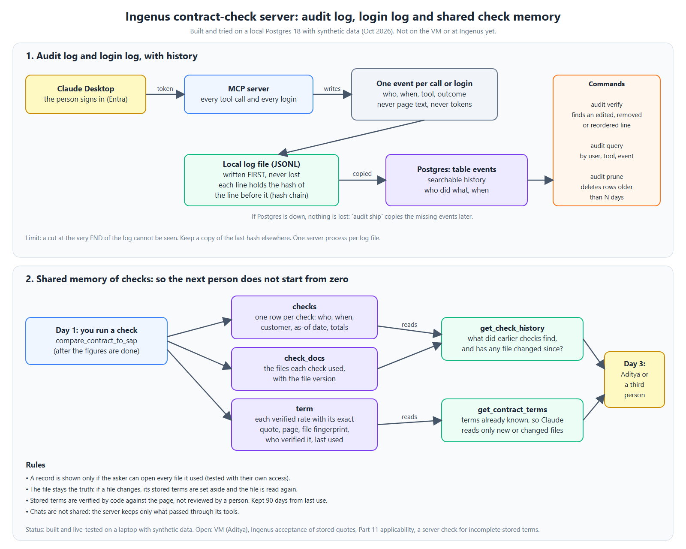

# Audit log, login log and shared check memory: how they work and what we learned

**Status (26 Oct 2026):** built and live-tested on a laptop with a local Postgres 18 and synthetic data. **Not** on the VM (Aditya provisions it, decision 0009) and **not** accepted by Ingenus (unknown).
**Diagram:**  (a copy of the PNG is in `2026/Solution_Approach/Audit_and_Check_Memory.png`).

**What "per-process memory" means here.** Aditya asked for a shared memory: one person checks a file on Day 1, another on Day 3, and a third sees what was found. **What he means exactly is not confirmed** (decision 0006). Our reading: the server keeps what passed through its tools. It cannot share anyone's Claude chat.

## 1. Audit log and login log, with history (decisions 0005, 0008)

- Every tool call and every login becomes one event: who, when, tool, outcome. Never page text, never tokens.
- The event is written to a local JSONL file **first**. Each line holds the hash of the line before it, so `audit verify` finds an edited, removed or reordered line.
- The events are copied to Postgres (table `events`) for searching. If Postgres is down nothing is lost; `audit ship` copies the missing events later (safe to repeat).
- `audit query` looks up events by user, tool or event; `audit prune` deletes rows older than N days.
- **Limits:** a cut at the very end of the log cannot be seen (keep the last hash elsewhere); one server process per log file.

## 2. Shared memory of checks: the database design (decisions 0006, 0011)

| Table | Holds | Read by |
|---|---|---|
| `checks` | One row per check: who, when, customer, as-of date, totals, summary | `get_check_history` |
| `check_docs` | The files each check used, with the file version | `get_check_history` |
| `term` | Each verified rate with its exact quote, page, file fingerprint, who verified it, last used | `get_contract_terms` |

- A record is shown only if the asker can open **every** file it used, tested with the asker's own access.
- **The file stays the truth.** A stored term is returned only while the file's fingerprint is unchanged; a changed file is read again (`changed_since_stored` names it).
- Stored terms are verified by code against the page, **not** reviewed by a person. Kept 90 days from last use.
- One storage layer (`core/db.py`) runs the same SQL on SQLite and Postgres. `INGENUS_PG_HOST` switches Postgres on; the password is read from a file and never logged.

## 3. What we learned (live QA, 23 to 26 Oct 2026)

1. **Build the per-user access object in the request thread.** Sources built inside worker threads lost the sign-in and said "needs a signed-in user" (the "Chain A not found" bug). A test now reproduces it.
2. **Write the local file first, copy to the database after.** The database is never a single point of failure for a tool call.
3. **Store only what code has verified, and re-verify on use.** A wrong term cannot get in without its quote being on the page.
4. **A file with any stored term is not read again, so stored terms can be incomplete.** In SR-4 Claude sent only Product A from Amendment 1; that file then counted as done. Guidance v5 says send every term in each file; a server-side completeness check is **not built** (ADR 0011).
5. **A stored term for an unlisted file is never returned.** With the network folder renamed, six stored Chain E terms were not used and Claude said the check was incomplete (SR-6b).
6. **Name the file that changed.** Claude blamed the wrong file until each file carried `changed_since_stored`.
7. **Tell the model what a number means.** Per-source file counts were read as "the same files"; the field description and guidance now say what they count.
8. **A flaky test was a real bug:** a same-length file rewrite with coarse clock granularity went unnoticed by the freshness check; the test is now length-independent.

## 4. Not done or unknown

- On the VM and at Ingenus (a later step). Ingenus's acceptance of stored quotes and figures is **unknown**; so is whether 21 CFR Part 11 applies.
- No accept or reject step for stored terms; no search index yet (next build).

**Evidence:** [demo_guide.md](../../MCP-Server/docs/demo_guide.md), sections 8b (sources) and 8c (stored terms, SR-1 to SR-6). Decisions: [0005](../decisions/0005-v1-audit-log-with-hash-chain-and-central-store.md), [0006](../decisions/0006-v1-shared-check-history-tool.md), [0008](../decisions/0008-v1-postgres-for-audit-store-and-check-history.md), [0011](../decisions/0011-v1-stored-contract-terms.md).
